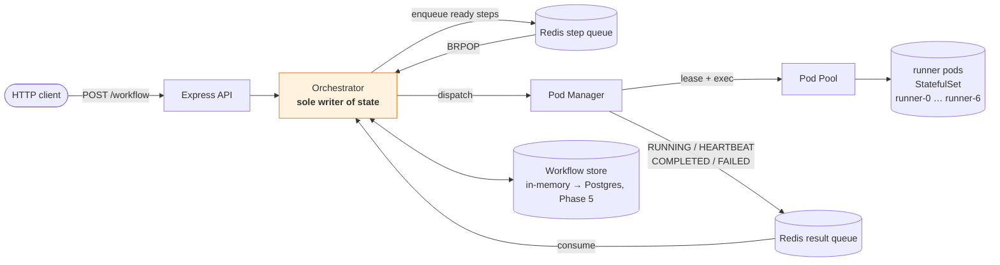

# kubedag

A DAG workflow orchestrator that runs each step's code in an isolated
Kubernetes pod. You submit a graph over HTTP, the engine resolves dependencies,
dispatches ready steps to a pool of warm runner pods, and drives every run to a
terminal state.

Architecture follows
[mr-raj12/Runexus](https://github.com/mr-raj12/Runexus) — control plane /
data plane split, Redis queues between them, pod manager that only observes.
Deviations and their reasoning are recorded in [ADRs](docs/adr/).

> **Status: Phase 0.** Layout, types, config, the `Runtime` interface, the pure
> DAG module, manifests, and one-command setup. Nothing executes a step yet.

---

## Architecture



**The invariant that makes this tractable:** the pod manager *observes and
reports*; the orchestrator *decides*. It has no store to write to, so
"what is this step's status" has exactly one possible answer.

### Components

| Component | Owns | Must never |
|---|---|---|
| `backend/server.ts` | HTTP surface, input bounds | decide scheduling |
| `backend/orchestrator.ts` | all run/step state, watchdog, dispatch | run user code |
| `backend/dag.ts` | validation, ready steps, skip propagation | touch I/O or a clock |
| `pod-manager/pod-manager.ts` | running one step, emitting heartbeats | read or write workflow state |
| `k8s/pod-pool.ts` | discovery, leases, exec, cleanup, liveness | interpret step outcomes |
| `queue/*` | FIFO transport | hold state |
| `runtime/runtime.ts` | the execution seam | — |

## Quickstart

```bash
bun install
./scripts/setup.sh

curl -s localhost:3000/healthz
curl -s localhost:3000/pods

curl -X POST localhost:3000/workflow \
  -H 'Content-Type: application/json' \
  -d '{"workflowId":"wf-1","steps":[
        {"id":"A","command":"echo hello"},
        {"id":"B","command":"ls /","dependsOn":["A"]},
        {"id":"C","command":"pwd","dependsOn":["A"]},
        {"id":"D","command":"date","dependsOn":["B","C"]}
      ]}'

curl -s localhost:3000/workflow/wf-1
```

`A` runs first, `B` and `C` in parallel, then `D`.

Prereqs: `docker`, `kind`, `kubectl`, `bun`. Every setting has a default — see
`.env.example`.

## Development

```bash
bun run typecheck   # tsc --noEmit, strict + noUncheckedIndexedAccess
bun test            # unit tests
bun run setup       # one-command stack
bun run teardown
```

## How a step flows

1. Client submits. `validateWorkflow` (pure) rejects anything malformed with a
   precise `400`.
2. Orchestrator stores state, **then** enqueues dependency-free steps as
   `QUEUED`.
3. Drain loop `BRPOP`s a step and dispatches it.
4. Pod manager leases a pod, reports `RUNNING`, starts heartbeating, execs the
   command.
5. On completion it reports `COMPLETED`/`FAILED`, then releases the pod after
   scrubbing it.
6. Orchestrator re-resolves the DAG and enqueues whatever became ready.
7. When every step is terminal, the run is `completed` or `failed`.

## Liveness and termination

Two independent bounds, because neither alone is sufficient
([ADR 0002](docs/adr/0004-attempt-fencing.md)):

| Mechanism | Detects | Gap it cannot close |
|---|---|---|
| Heartbeat watchdog | pod died — silence | a hung command on a live pod heartbeats forever |
| Execution timeout | command wedged | cannot distinguish "slow" from "stuck" |

Terminal is final. A late heartbeat racing a watchdog timeout is dropped.

## Guarantees

| Property | Guarantee |
|---|---|
| Delivery | at-least-once via Redis; duplicates absorbed by terminal guard + `attemptId` |
| Ordering | per-step FIFO |
| Idempotency | user-side, via injected `ATTEMPT_ID` |
| **Exactly-once** | **not provided** |
| Terminal states | final — `COMPLETED`/`FAILED`/`SKIPPED`/`TIMED_OUT`/`CANCELLED` are absorbing |
| Termination | every run reaches a terminal state, given a working Redis |
| Step isolation | pods scrubbed between leases ([ADR 0003](docs/adr/0003-cleanup-between-leases.md)) |

**At-least-once, never exactly-once.** A step may run twice after a crash or
eviction. `ATTEMPT_ID` is exported into the step's environment so user code can
deduplicate; making retries safe is the user's responsibility.

## Non-goals (v1)

No exactly-once execution. No runtime DAG mutation. No multi-cluster. No
multi-tenancy beyond a namespace boundary. No Windows support. No progress
reporting finer than "heartbeat is alive".

## Layout

```
src/
  backend/       server.ts · orchestrator.ts · dag.ts · workflow-store.ts
  pod-manager/   pod-manager.ts
  k8s/           pod-pool.ts
  queue/         redis-client.ts · step-queue.ts · result-queue.ts
  runtime/       runtime.ts        the execution seam
  types/         workflow.ts       shared vocabulary
  config.ts
k8s/             namespace.yaml · rbac.yaml · runner-pod.yaml · runner/Dockerfile
scripts/         setup.sh · teardown.sh · build-image.sh
docs/adr/        decision log
test/            unit tests
```

## Roadmap

| Phase | Scope | State |
|---|---|---|
| 0 | Layout, types, config, `Runtime`, pure DAG, setup | **done** |
| 1 | State machine + transition table | next |
| 2 | Redis queues, pod pool leases, cleanup | |
| 3 | Pod manager, exec with timeout, heartbeats | |
| 4 | Orchestrator loop, watchdog, eviction | |
| 5 | Postgres persistence, migrations, reconciliation | |
| 6 | Retries, backoff, fencing | |
| 7 | Failure injection, crash recovery | |
| 8 | API completion, CLI, idempotency | |
| 9 | Security hardening | |
| 10 | Observability | |
| 11 | Load test + benchmarks | |
| 12 | Visualizer, demo | |

## License

MIT