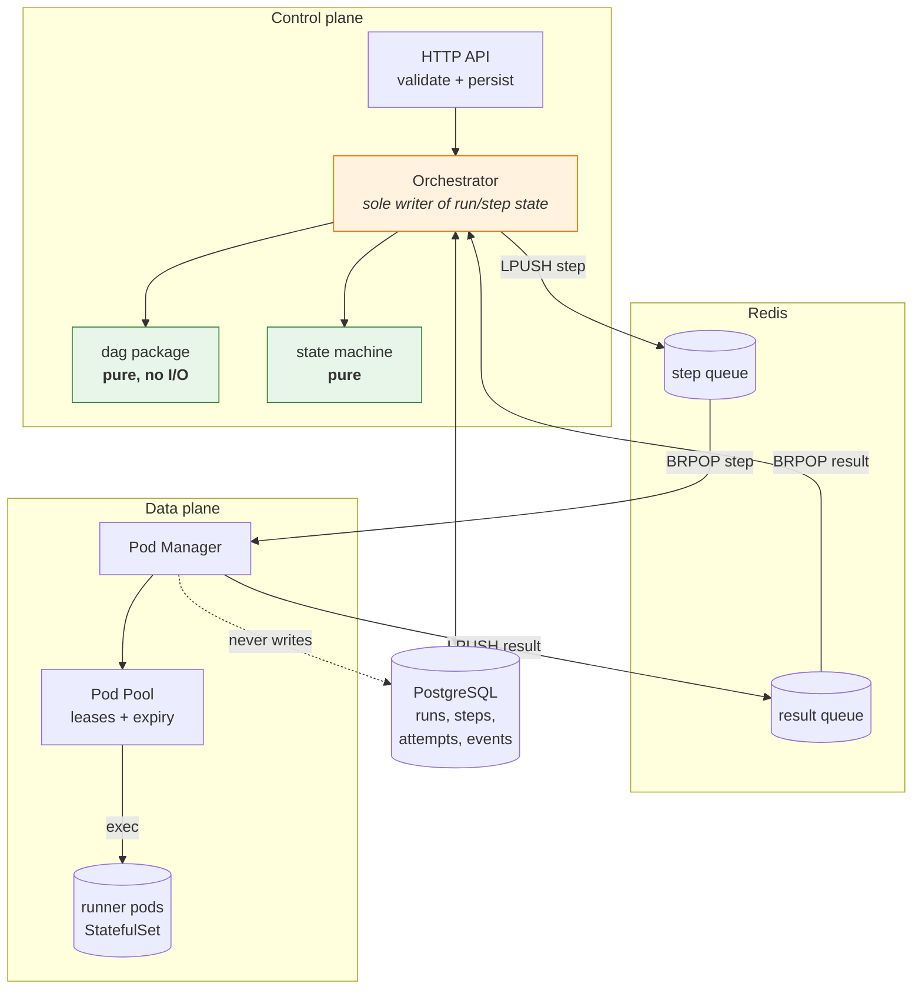

# kubedag

A DAG workflow orchestration engine that runs each step's code in an isolated
Kubernetes pod. Submitted over HTTP, validated as a pure function, executed
across a warm pod pool, and driven to a terminal state no matter what fails.

> **Status: Phase 0 complete.** Skeleton, types, `Runtime` interface, config,
> CI, and a one-command local stack. The DAG engine, pod manager, persistence
> and API land in Phases 1–12. Nothing here runs a step yet, by design.

---

## Architecture



**The load-bearing rule:** only the Orchestrator mutates run and step state.
The pod manager reports *observations* (`this command exited 137 on runner-2`);
the orchestrator decides *meaning* (that makes the step `FAILED`). One writer
means no distributed lock protocol for state transitions.

---

## Layout

```
cmd/
  orchestrator/     control plane binary (API + scheduling loop)
  podmanager/       data plane binary (leases, exec, cleanup)
  cli/              thin HTTP client
internal/
  domain/           types + state enums. Pure. No I/O, ever.
  runtime/          Runtime interface: the Kubernetes seam
  config/           env-driven config with documented defaults
deploy/
  infra/            redis + postgres manifests
  runner/           runner StatefulSet + runner Dockerfile
  kind/             kind cluster config
scripts/
  dev-up.sh         one-command local stack
  dev-down.sh       teardown
```

## Quickstart

```bash
make dev-up     # kind + redis + postgres + runner pool + both binaries
curl -s localhost:8080/healthz
curl -s localhost:8080/readyz
make dev-down
```

Requires `go`, `docker`, `kind`, `kubectl`. Every knob has a default; see
`internal/config/config.go` for the full list with `KUBEDAG_` prefixes.

> The Go binaries run **on the host**, not as pods, so you can `kill -9` them
> to test crash recovery without an image rebuild. Deliberate DX trade-off.

## Development

```bash
make lint      # gofmt + vet
make test      # unit tests
make test-race # with the race detector
make cover     # coverage summary
make help      # all targets
```

## Roadmap

| Phase | Scope | State |
|---|---|---|
| 0 | Layout, types, `Runtime` interface, config, local stack | **done** |
| 1 | Pure DAG: validation, ready-step computation, skip propagation | next |
| 2 | State machine + transition table | |
| 3 | Pod pool, leases, exec, cleanup between leases | |
| 4 | Redis queues, pod manager, orchestrator loop, watchdog | |
| 5 | PostgreSQL persistence + migrations | |
| 6 | Retries, backoff, fencing tokens, stale-result rejection | |
| 7 | Reconciliation + crash recovery + failure injection | |
| 8 | API completion, CLI, idempotency | |
| 9 | Security hardening | |
| 10 | Observability | |
| 11 | Load test + benchmarks | |
| 12 | Visualizer, docs, demo | |

## Guarantees

Filled in as phases land. The headline commitments:

- **At-least-once execution, never exactly-once.** A step may run more than
  once after a crash. `ATTEMPT_ID` is injected into the environment so user
  code can deduplicate; making retries safe is the user's responsibility.
- **Terminal is final.** No transition out of `SUCCEEDED`/`FAILED`/`CANCELLED`
  at either the run or step level.
- **Deterministic termination.** Every run reaches a terminal state via
  per-step timeout plus heartbeat watchdog.

## Non-goals (v1)

No exactly-once execution. No DAG mutation at runtime. No multi-cluster. No
multi-tenancy beyond a namespace boundary. No Windows support.

## License

MIT