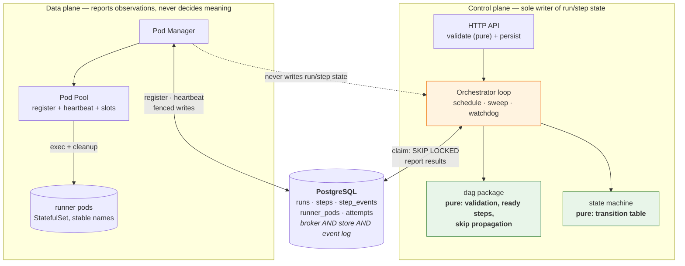

# kubedag

A DAG workflow orchestration engine that runs each step's code in an isolated
Kubernetes pod. Submitted over HTTP, validated as a pure function, executed
across a warm pod pool, and driven to a terminal state no matter what fails.

> **Status: Phase 0 complete.** Skeleton, types, `Runtime` interface, config,
> CI, and a one-command local stack. The DAG engine, pod manager, persistence
> and API land in Phases 1–12. Nothing here runs a step yet, by design.

## Architecture

Grounded in
[hatchet-dev/durable-execution-the-hard-way](https://github.com/hatchet-dev/durable-execution-the-hard-way)
— a durable execution engine built on Postgres alone. We adopt its patterns
rather than inventing new ones. See [ADRs](docs/adr/) for the reasoning.



**No Redis.** Postgres is the broker, the store, and the event log. Dequeue is
a single statement with `FOR UPDATE SKIP LOCKED`, which makes "this step
exists" and "this step is claimed" one atomic operation — there is no
dual-write window. ([ADR 0001](docs/adr/0001-postgres-broker.md))

### Patterns inherited from the reference implementation

| Reference repo | kubedag |
|---|---|
| `PollTasks` (`SKIP LOCKED`) | claim ready steps |
| `workers` + `last_heartbeat_at` | `runner_pods` registry |
| `PollTasksOnInactiveWorkers` | evict steps off silent pods |
| durable → `ReassignTask` / non-durable → `UpdateTaskFailed` | **kept as-is** ([ADR 0002](docs/adr/0002-evict-durable-retry-others.md)) |
| `durable_events(task_id, event_id, kind, key, child_task_id)` | `step_events(run_id, step_id, event_id, kind, key)` |
| `(task_id, retry_count, worker_id)` fence | `(run_id, step_id, attempt, pod_id)` fence ([ADR 0003](docs/adr/0003-state-derived-fencing.md)) |
| `createKey` sha256 → `NonDeterminismErr` | identical |
| sem / `len(w.sem)` → SQL `LIMIT` | per-run + global concurrency |
| scheduling vs execution timeout | same distinction, same retry semantics |

**One deliberate divergence:** the reference repo's `DurableContext.RunTask`
lets a workflow invoke children *dynamically*. kubedag's DAG is declared up
front, so there is no `RunTask` — the orchestrator computes readiness instead.
The event log still earns its place for crash-resume.

---

## Layout

```
cmd/
  orchestrator/     control plane binary (API + scheduling loop)
  podmanager/       data plane binary (leases, exec, cleanup)
  cli/              thin HTTP client
internal/
  domain/           types + state enums. Pure. No I/O, ever.
  runtime/          Runtime interface: the Kubernetes seam
  config/           env-driven config with documented defaults
deploy/
  infra/            postgres manifests
  runner/           runner StatefulSet + runner Dockerfile
  kind/             kind cluster config
docs/
  adr/              decision log (ADR 0001-0003)
scripts/
  dev-up.sh         one-command local stack
  dev-down.sh       teardown
```

## Quickstart

```bash
make dev-up     # kind + postgres + runner pool + both binaries
curl -s localhost:8080/healthz
curl -s localhost:8080/readyz
make dev-down
```

Requires `go`, `docker`, `kind`, `kubectl`. Every knob has a default; see
`internal/config/config.go` for the full list with `KUBEDAG_` prefixes.

> The Go binaries run **on the host**, not as pods, so you can `kill -9` them
> to test crash recovery without an image rebuild. Deliberate DX trade-off.

## Development

```bash
make lint      # gofmt + vet
make test      # unit tests
make test-race # with the race detector
make cover     # coverage summary
make help      # all targets
```

## Roadmap

| Phase | Scope | State |
|---|---|---|
| 0 | Layout, types, `Runtime` interface, config, local stack | **done** |
| 1 | Pure DAG: validation, ready-step computation, skip propagation | next |
| 2 | State machine + transition table | |
| 3 | Pod pool, leases, exec, cleanup between leases | |
| 4 | Pod pool runtime, orchestrator loop, heartbeat watchdog | |
| 5 | PostgreSQL persistence + migrations | |
| 6 | Retries, backoff, fencing tokens, stale-result rejection | |
| 7 | Reconciliation + crash recovery + failure injection | |
| 8 | API completion, CLI, idempotency | |
| 9 | Security hardening | |
| 10 | Observability | |
| 11 | Load test + benchmarks | |
| 12 | Visualizer, docs, demo | |

## Guarantees

Filled in as phases land. The headline commitments:

| Property | Guarantee | Mechanism |
|---|---|---|
| Delivery | at-least-once | `SKIP LOCKED` claim; eviction re-queues |
| Exactly-once | **not provided** | see below |
| Ordering | per-step FIFO | `ORDER BY id` within a run |
| Idempotency | user-side only | `ATTEMPT_ID` injected into step env |
| Fencing | `(attempt, pod_id)` | stale writes rejected, ADR 0003 |
| Terminal | final | `SUCCEEDED`/`FAILED`/`CANCELLED` are absorbing |
| Termination | deterministic | per-step timeout + heartbeat watchdog |

**At-least-once, never exactly-once.** A step may run more than once after a
crash or eviction. `ATTEMPT_ID` is injected so user code can deduplicate;
making retries safe is the user's job. We do not pretend otherwise.

**Heartbeat proves liveness, not progress.** A step wedged in an infinite loop
inside a healthy pod will heartbeat forever. That is why the per-step timeout
and the heartbeat watchdog are independent mechanisms, not one.

## Non-goals (v1)

No exactly-once execution. No DAG mutation at runtime. No multi-cluster. No
multi-tenancy beyond a namespace boundary. No Windows support.

## License

MIT